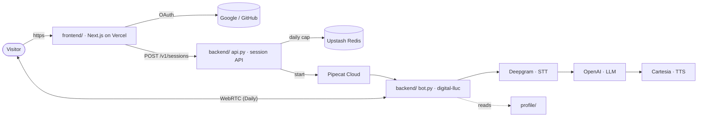

# lluc.sh: talk to digital-lluc


My personal website. The main product is a conversation: **digital-lluc**, a
first-person AI version of me you can talk to by voice or text.



## Layout

- `frontend/`: Next.js app, Auth.js sign-in, the conversation console, the blog.
- `backend/`: one Python package with two roots: `api.py` (session API with a
  per-visitor daily cap) and `bot.py` (the Pipecat bot). `backend/evals/` holds
  the end-to-end evals.
- `profile/`: the YAML the persona is built from.

## Local development

```bash
make setup
cp backend/.env.example backend/.env          # DEEPGRAM_, OPENAI_, CARTESIA_API_KEY; AUTH_TOKEN_SECRET=$(openssl rand -hex 32)
cp frontend/.env.example frontend/.env.local  # same AUTH_TOKEN_SECRET; LOCAL_DEV_USER_EMAIL skips sign-in
make dev-bot   # terminal 1
make dev-api   # terminal 2
make dev-web   # terminal 3
```

`make check` lints, type-checks, tests and builds everything. `make eval` talks
to the real bot by voice and grades its answers with OpenAI; it spends a few
cents of OpenAI, Deepgram and Cartesia credit per run.

## CI and deploy

Every PR runs `make check` and `make eval`. The eval uses the repository secrets
`OPENAI_API_KEY`, `DEEPGRAM_API_KEY` and `CARTESIA_API_KEY`, so an expired key
or an empty balance fails the PR. Merging to main deploys the bot to Pipecat
Cloud; Vercel deploys `frontend/`.
